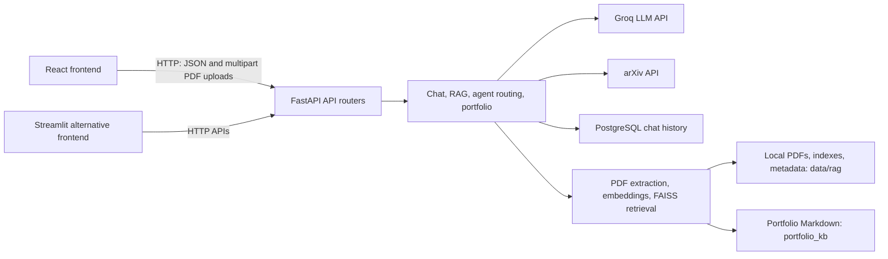

# ResearchMate

**An AI research assistant for conversational chat, PDF question answering, and research paper discovery.**

ResearchMate combines a React workspace with a FastAPI backend for retrieval-augmented generation (RAG), Groq-hosted language models, and PostgreSQL-backed conversation history. Upload a paper, ask questions about its content, or enable Agent Mode to route requests to document analysis and arXiv discovery.


## Features

| Capability | Current behavior |
| --- | --- |
| **Normal Chat** | Conversational responses with session-based message history. |
| **Document Q&A (RAG)** | Upload a PDF, extract and chunk its text, build a persistent FAISS index, and answer questions using retrieved context. One attached document is used at a time. |
| **Agent Mode** | Classifies a request and routes it to one capability: chat, document Q&A, document summarization, arXiv search, or topic-based paper recommendations. Uses a single-pass router. |
| **Research paper discovery** | Search arXiv or request recommendations in Agent Mode; results include paper information, abstract excerpts, and paper/PDF links. |
| **Document summarization** | Ask Agent Mode to summarize an uploaded document. Summaries use retrieved chunks, rather than a dedicated pass over every page. |
| **Chat settings** | Adjust temperature from 0 to 1 and maximum tokens from 1 to 2,048. The current model option is **GPT OSS**, mapped to `openai/gpt-oss-20b` through Groq. |
| **Multilingual responses** | Select English, Hindi, Spanish, French, or German for AI answers and welcome messages. arXiv result formatting remains English. |
| **Conversation history** | FastAPI stores messages in PostgreSQL and exposes retrieval and clearing by session ID. React loads history for its active session. |
| **React workspace** | Responsive layout, Markdown/GFM answer rendering, PDF attachment controls, loading/error states, and About Chatbot / About Developer pages. |
| **Response continuation** | The backend LLM wrapper can request bounded continuations when generation is detected as truncated. |
| **Portfolio API** | A separate backend route answers developer questions using the Markdown knowledge base in `portfolio_kb/`. |

React retains chat settings in browser session storage, but conversation IDs, messages, and attachments stay in memory. **Refreshing the page starts a new conversation**; previous messages remain in the database under their original session ID. The UI does not provide an archive of previous sessions.

Document Q&A currently returns an empty `sources` array reserved for future use; extracted source citations are not yet available. Chat responses are returned as complete HTTP responses, without a token-streaming API.

## Tech Stack

| Layer | Technologies used |
| --- | --- |
| React frontend | React, TypeScript, Vite, Tailwind CSS, React Router |
| Answer rendering | `react-markdown`, `remark-gfm` |
| Alternative frontend | Streamlit, Python HTTP client |
| HTTP backend | FastAPI, Uvicorn, Pydantic |
| LLM inference | Groq via `langchain-groq`; GPT OSS (`openai/gpt-oss-20b`) |
| RAG orchestration | LangChain Classic / Community, recursive character splitting |
| Application embeddings | Hugging Face Sentence Transformers: `all-MiniLM-L6-v2` |
| Vector search | FAISS CPU with indexes persisted on disk |
| PDF extraction | PyMuPDF through LangChain's PDF loader |
| Persistence | PostgreSQL, SQLAlchemy Core, psycopg2 |
| Paper discovery | arXiv Python client |
| Development and CI | ESLint, TypeScript, Ruff, pytest, GitHub Actions, Gitleaks |

Hugging Face supplies embedding models; the current LLM implementation uses Groq. Dependencies are declared in [requirements.txt](requirements.txt), [requirements-test.txt](requirements-test.txt), and [react-frontend/package.json](react-frontend/package.json).

## System Architecture

React communicates with FastAPI **exclusively through HTTP APIs**. API services and TypeScript request/response types live inside `react-frontend/`; the browser does not import Python modules or directly access PostgreSQL, FAISS, backend files, or provider credentials.



FastAPI validates requests, delegates to core services, and persists conversation messages. PDF ingestion uses 500-character chunks with 50-character overlap. Uploaded PDFs, document indexes, and metadata live under `data/rag/`; the portfolio retriever is built at API startup from `portfolio_kb/`.

React builds independently into static assets. `VITE_API_BASE_URL` selects the backend origin, allowing the frontend and API to run or deploy separately. See [PROJECT_DEEP_DIVE.md](PROJECT_DEEP_DIVE.md) for longer technical background; some older model, setup, and evaluation descriptions there predate this README.

## Project Structure

```text
ResearchMate/
|-- react-frontend/          # Independently runnable React application
|   |-- src/
|   |   |-- app/            # Navigation and browser session context
|   |   |-- components/     # Shared layout, UI, and About components
|   |   |-- features/       # Chat, PDF documents, and settings
|   |   |-- pages/          # Chat, About Chatbot, About Developer
|   |   |-- services/api/   # HTTP client and endpoint helpers
|   |   `-- types/          # TypeScript API contracts
|   |-- public/             # Static assets
|   |-- package.json
|   `-- vite.config.ts
|-- backend/
|   |-- main.py             # FastAPI entry point and router registration
|   |-- api/                # Chat, RAG, documents, agent, history, portfolio
|   |-- schemas/            # Pydantic request/response models
|   |-- core/               # LLM services, RAG, database config, chat history
|   |-- schema.sql          # chat_messages table definition
|   `-- init_db.py          # Legacy initializer; see setup caveat below
|-- app.py                  # Streamlit entry point
|-- views/                  # Streamlit pages
|-- streamlit_frontend/     # Streamlit API client and styling utilities
|-- portfolio_kb/           # Markdown knowledge base for the portfolio API
|-- eval/                   # Dataset loader, metrics, evaluation runner
|-- pdf/arxiv/              # Local benchmark data; ignored by Git
|-- data/rag/               # Runtime PDFs, indexes, metadata; ignored by Git
|-- .github/workflows/      # Python checks, EC2 deployment, secret scanning
|-- requirements.txt
|-- requirements-test.txt
|-- PROJECT_DEEP_DIVE.md
`-- LICENSE
```

`pdf/arxiv/` and `data/rag/` are local data locations, not files supplied by a fresh clone. A `tests/` directory is referenced in project guidance, but is absent from this branch's checkout.


## Evaluation & Testing

### RAG evaluation

The [evaluation code](eval/) loads an Open RAG Benchmark-style arXiv dataset from `pdf/arxiv/`, builds a FAISS index, retrieves up to ten chunks, and optionally generates answers. It expects `queries.json`, `qrels.json`, `answers.json`, and section-level JSON documents under `corpus/`. The dataset is ignored by Git and must be supplied separately; the repository does not include an automated dataset download command.

| Metric | Implementation |
| --- | --- |
| Recall@3, Recall@5, Recall@10 | Fraction of evaluated queries with at least one relevant chunk in the top K; a hit-rate definition. |
| Mean Reciprocal Rank (MRR) | Average reciprocal rank of the first relevant chunk. |
| Average groundedness | Answer/context token overlap after lowercasing and stopword removal. |
| Grounded ratio | Fraction of evaluated answers with overlap at or above the code's **0.20** threshold. |


ResearchMate is released under the [MIT License](LICENSE), copyright Mitesh Gupta.
